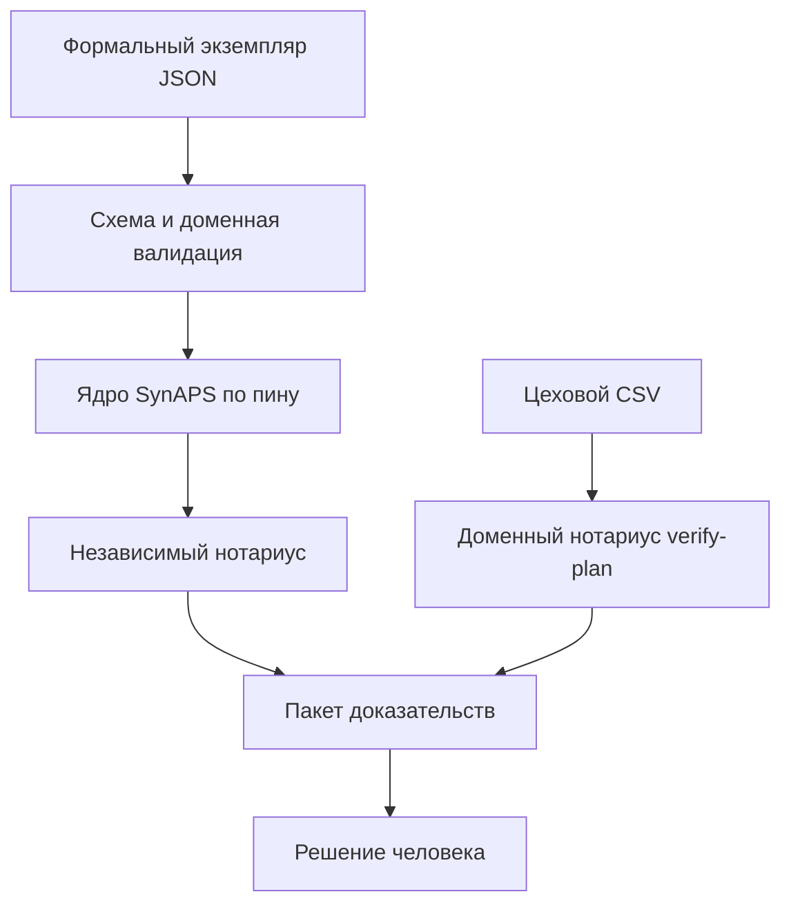

# SynAPS RepairFlow

RepairFlow строит график ремонта агрегатов и отдельно решает, можно ли этому графику верить.

Ядро [SynAPS](https://github.com/KonkovDV/SynAPS) ищет свободные слоты. Этот репозиторий описывает ремонтную задачу: карта, пост, бригада, оснастка, переналадка, смены, запчасти, обменный фонд. Потом отдельный код, нотариус, сверяет готовый график с исходной задачей. Если что-то не сходится, в ответе код причины, русская формулировка, идентификаторы и интервал.

Это лабораторная работа на синтетических данных. Решение остаётся за человеком. Во время расчёта программа в сеть не ходит. Если страница расходится с [`docs/limitations.md`](docs/limitations.md) или с таблицей ниже, верны они.

[](https://github.com/KonkovDV/SynAPS-RepairFlow/actions/workflows/ci.yml)
[](LICENSE)

Значок CI — последний прогон workflow. Аттестованная ревизия названа в таблице «Что уже проверено». Значок её не заменяет.

## Содержание

- [Зачем разведены поиск и проверка](#зачем-разведены-поиск-и-проверка)
- [Как читать ответ](#как-читать-ответ)
- [Как запустить](#как-запустить)
- [Команды](#команды)
- [Как устроена проверка](#как-устроена-проверка)
- [Что именно сверяется](#что-именно-сверяется)
- [Что уже проверено](#что-уже-проверено)
- [Соседние программы](#соседние-программы)
- [Чего в этой сборке нет](#чего-в-этой-сборке-нет)
- [Проверка перед правкой](#проверка-перед-правкой)
- [Куда смотреть дальше](#куда-смотреть-дальше)
- [English](#english)

## Зачем разведены поиск и проверка

План ремонта связан сразу в нескольких местах. Решатель может вернуть короткий график и при этом потерять операцию, поставить бригаду без допуска или увести обменный фонд в минус. Если «годится» говорит тот же код, который искал слоты, свою ошибку он не видит.

Поиск и проверка здесь разведены. Нотариус не подключает код поиска. Короткий общий срок не считается улучшением, если покрытие дырявое или появилось жёсткое нарушение.

Режим теневой. Программа не выпускает технику на линию, не пишет в учётную систему и не заменяет контур безопасности.

## Как читать ответ

| Слово в результате | Когда оно честное |
| --- | --- |
| `verified` | Все операции на месте, жёстких замечаний нет, ядро ответило `feasible` или `optimal`. |
| `domain_verified` | Цеховой CSV прошёл `repairflow verify-plan`. Ядро не вызывалось. Поле `verified_feasible` при этом ложное. |
| `optimal` | CP-SAT вернул `OPTIMAL` на исходной цепочке, за один проход компилятора, и нотариус пуст. Эвристика это слово не получает. |
| `rejected` | Есть жёсткое нарушение, дыра в покрытии, недопустимость или непонятный статус ядра. |

Код выхода повторяет этот ответ, его можно поставить в скрипт.

| Код выхода | Что произошло |
| --- | --- |
| ноль | `verified`, `optimal` или `domain_verified`. У `compare` ни одно замороженное назначение не сломано. У `demo` все проверки готовности прошли. |
| два | Отказ с причинами: жёсткое нарушение, неполное покрытие, недопустимость, ошибка ядра или сдвиг замороженного назначения. |
| один | Файл не прочитан, хеши не сошлись при `check --verify-hashes`, команда собрана неверно или `demo` не прошло. |

## Как запустить

Нужная версия Python записана в поле `requires-python` файла [`pyproject.toml`](pyproject.toml). При установке подтянется ядро SynAPS по полному SHA. Дальше сеть не нужна.

```bash
python -m venv .venv
source .venv/bin/activate          # PowerShell: .venv\Scripts\Activate
python -m pip install -e ".[dev]"
repairflow version
repairflow demo --out out
```

`demo` само собирает синтетический пример, сравнивает FIFO и GREED, перестраивает график после сбоя с замороженными назначениями и отдаёт нотариусу нарочно испорченный план. Испорченный план должен быть отвергнут. Рядом появляются чужой цеховой лист, доменный отказ без ядра, минимальный по удалению свидетель и строка журнала по принятому GREED. Без флага `--skip-cpsat` на маленьком примере ещё прогоняется CP-SAT. Последняя строка при успехе: `MVP readiness: PASS`. Если хоть одна проверка сорвалась, код выхода — один.

Лабораторный образ и запуск с корнем только для чтения описаны в [`docs/runbook.md`](docs/runbook.md). Проверки живости у образа нет: контейнер завершается вместе с командой.

## Команды

```bash
repairflow synthesize --preset tiny --out out/tiny.json
repairflow solve out/tiny.json --out out/greed.json
repairflow solve out/tiny.json --preset FIFO --out out/fifo.json
repairflow check out/tiny.json out/greed.json --verify-hashes --report out/check.json
repairflow check out/tiny.json out/fifo.json
repairflow compare out/tiny.json out/fifo.json out/greed.json --out out/diff.json
repairflow report out/tiny.json out/greed.json --md out/greed.md --html out/greed.html
```

На `tiny` FIFO нотариус отвергает: посты и бригады наезжают друг на друга, допуск не тот. GREED на том же примере проходит.

| Команда | Зачем | Что остаётся на диске |
| --- | --- | --- |
| `synthesize` | Собрать синтетическую задачу по пресету и зерну `--seed`. | JSON по [схеме задачи](schemas/repairflow.problem.v1.json). |
| `solve` | Построить график выбранной настройкой и сразу прогнать нотариуса. | JSON: назначения, вердикт, причины, хеши входа, результата и настройки. |
| `check` | Только проверка уже готового плана. С `--verify-hashes` сначала сверяются хеши. | Причины на экран, отчёт в файл `--report`. |
| `verify-plan` | Проверка цехового CSV по [шаблону](schemas/templates/shop-plan.csv). Ядро не вызывается. | Русские причины с идентификатором операции, результат в `--out`. |
| `compare` | Сравнить два плана и найти сломанные замороженные назначения. | JSON разницы по [схеме](schemas/repairflow.diff.v1.json). |
| `report` | Текст и HTML с диаграммой Ганта. | Файлы `--md` и `--html`. |
| `disrupt` | Перестроить график после сбоя одной операции. Остальное заморожено. | Новый JSON результата. |
| `inspect` | Дефектовка открывает ветку карты. Остальные агрегаты заморожены. | Новый JSON результата. |
| `benchmark` | FIFO против GREED на наборе пресетов и зёрен. | `benchmark.json`, `.md`, `.html` и отчёты по каждому примеру. |
| `decide` | Записать решение человека по файлам задачи и результата. Ненулевой код выхода нельзя принять. | Строка JSONL в журнале. |
| `log verify` | Пересчитать цепочку журнала. Если вершина хранится отдельно, пропавший хвост — ошибка. | Код выхода. |
| `log witness` | HMAC вершины ключом из файла. Это не подпись выпуска. | Строка хеша. |
| `log stats` | Счётчики журнала без кода оператора. | Текст на экран. |

## Как устроена проверка



Опубликованный вердикт `verified` ещё читает проверку допустимости закреплённого SynAPS. Независимость относится к поиску, не ко всей обвязке ядра. `repairflow verify-plan` ядро не вызывает.

Несколько правил, на которых держится сверка:

- Ёмкость `K` — это `K` одинаковых полос. Занятость — полуинтервал `[start, end)`: если один визит кончился ровно тогда, когда начался другой, это не пересечение.
- Переналадка удлиняет занятость назад. В одну и ту же минуту сначала обрабатывается окончание, потом начало. Обычные и замороженные назначения идут одним обходом.
- Ответ не зависит от того, в каком порядке множество обошло само себя. Стоки карты обменного фонда сортируются по идентификатору операции.
- В каждый результат пишутся хеши входа, результата и настройки. `check --verify-hashes` отказывает, если они разъехались.

```text
false_accept_rate = invalid_plans_accepted_as_verified / invalid_plans_presented
```

Для примеров оракула правильности цель такая: ни один заведомо плохой план не должен пройти как проверенный. Оракул по минутам обменный фонд не судит. Если оракул и нотариус разошлись, пример разбирают руками. Оракул под нотариус не подгоняют.

## Что именно сверяется

Схема отбрасывает неполный и двусмысленный вход. Дальше каждое назначение сверяется с исходной задачей. Полный список кодов и русских фраз лежит в [`src/repairflow/reasons.py`](src/repairflow/reasons.py). У каждой причины есть подсказка, что поправить: сдвинуть слот, взять другой пост, назначить бригаду с живым допуском.

| О чём речь | Коды |
| --- | --- |
| Покрытие и однозначность | `PARTIAL_COVERAGE`, `UNKNOWN_OPERATION`, `UNKNOWN_RESOURCE`, `DUPLICATE_ASSIGNMENT`, `JOB_MISMATCH` |
| Порядок операций и лаги | `PRECEDENCE_BROKEN` |
| Посты | `CENTER_OVERLAP`, `ELIGIBLE_CENTER_MISMATCH` |
| Бригады и допуски | `CREW_OVERLAP`, `CREW_UNBOUND`, `AMBIGUOUS_CREW`, `SKILL_MISMATCH`, `SKILL_EXPIRED` |
| Календарь, окна, горизонт | `CALENDAR_BROKEN`, `WINDOW_BROKEN`, `HORIZON_VIOLATION`, `RELEASE_VIOLATION`, `INVALID_DURATION` |
| Оснастка и переналадка | `AUX_OVERLAP`, `AUX_MISSING`, `MISSING_SETUP`, `SETUP_MISMATCH` |
| Запчасти и обменный фонд | `SPARE_UNAVAILABLE`, `EXCHANGE_POOL_STOCKOUT` |
| Замороженное | `FROZEN_MOVED` |
| Сроки | `DEADLINE_MISSED` жёсткий. `DUE_MISSED` мягкий: это показатель, не отказ |
| Статус ядра и сборка карты | `KERNEL_STATUS_MISSING`, `KERNEL_STATUS_UNKNOWN`, `KERNEL_STATUS_NOT_FEASIBLE`, `DAG_FIXPOINT_NOT_CONVERGED`, `CPSAT_OPS_CAP` |

## Что уже проверено

Таблицу между метками собирает `tools/attest.py`. Она относится только к той ревизии `main`, чей собственный прогон после вливания прошёл целиком, включая `test-slow`. На этой странице цифра допустима только внутри таблицы. Слова «ноль» и «пусто» выше говорят о коде выхода и о цели оракула, это не новый замер. Сводка для папки подачи собирается отдельно, в [`docs/submission-facts.md`](docs/submission-facts.md), и сюда не копируется.

<!-- evidence:begin -->
| Факт | Значение |
|---|---|
| Проверенный `main` | [`e34f782`](https://github.com/KonkovDV/SynAPS-RepairFlow/commit/e34f7825b43b574fb311cca9b35edf91f7d6f31d) |
| CI для этого `main` | [Actions run 38754698950](https://github.com/KonkovDV/SynAPS-RepairFlow/actions/runs/38754698950), success, включая `test-slow` |
| Sweep-line commit | [`a3621fd`](https://github.com/KonkovDV/SynAPS-RepairFlow/commit/a3621fd538019f4dcc0c681d5634c022260382e9) |
| SynAPS pin | [`f939727`](https://github.com/KonkovDV/SynAPS/commit/f939727cd9369fd9b36438bfac7198f0c39c6d3b) |
| Solver | `ortools==9.15.6755` |
| Benchmark | [`benchmark/results/benchmark.json`](benchmark/results/benchmark.json), SHA-256 `5cccd7d9045d36ca1d920f291f3263d2ed311685db79adf12c9769f14324b381`, claim `experiment` |
| Fault campaign | checked 10080, false_accept 0, false_reject 0, presets `tiny, repair-site-mvp`, solvers `GREED, EDD, ATC` |
| Манифест отстаёт от HEAD | да |
| Данные | committed synthetic fixtures; customer data отсутствуют |
| Зрелость | laboratory fixture / TRL 4; не pilot result |
<!-- evidence:end -->

Голое число ничего не доказывает. К нему нужны ревизия, откуда взяты данные, зерно генератора, статус решателя, вывод нотариуса и знаменатель. Машиночитаемая копия таблицы — [`docs/evidence-manifest.json`](docs/evidence-manifest.json), правила — в [протоколе](docs/evidence-protocol.md).

## Соседние программы

RepairFlow не предлагает новый универсальный решатель. Своё здесь другое: договорённость о том, как устроена ремонтная задача, сборка этой задачи в закреплённое ядро, отдельный нотариус, который при сомнении отказывает, повторяемые хеши и теневой разбор, где последнее слово за человеком. Ссылки и оговорки — в [обзоре](docs/literature-2026.md).

У [Timefold](https://github.com/TimefoldAI/timefold-quickstarts) есть пример планирования обслуживания: жёсткие ограничения и мягкий желаемый срок. Счёт там считает та же модель, по которой шёл поиск. Здесь отказ выносит другой код. Мягкий срок и здесь только показатель, код `DUE_MISSED`.

[OR-Tools CP-SAT](https://developers.google.com/optimization) умеет сказать `OPTIMAL` про свою модель. Этот статус попадает нотариусу на вход. Слово `optimal` в результате RepairFlow появляется только у чистого прогона на исходной цепочке.

Учётная система остаётся источником заказов, карт и остатков. [Карта полей](docs/data-mapping-1c-toir.md) показывает, какое поле куда легло бы. Обмена с учётной системой нет.

Рядом лежат другие публичные репозитории [KonkovDV](https://github.com/KonkovDV). Их отчёты сюда не переносятся.

| Репозиторий | Что это |
| --- | --- |
| [SynAPS](https://github.com/KonkovDV/SynAPS) | Ядро, которое ищет слоты. Здесь от него только пин в таблице выше. |
| [SynAPS-GridPlan](https://github.com/KonkovDV/SynAPS-GridPlan) | Лабораторное планирование обслуживания энергооборудования. Другой домен и другой пин. |
| [SynAPS-ProgramPlan](https://github.com/KonkovDV/SynAPS-ProgramPlan) | Сводный план программы и журнал решений с цепочкой хешей. Здешний журнал пишет `repairflow decide`. Подписи у него нет. |
| [SynAPS-MobiRoute](https://github.com/KonkovDV/SynAPS-MobiRoute) | Перевозка по вызову. К ремонту и к этому нотариусу не относится. |
| [AeroBIM](https://github.com/KonkovDV/AeroBIM) | Находка несёт пункт и идентификатор, а годность ставит отдельный контур. Оттуда взята форма ответа: код, идентификаторы, интервал. |
| [RailBreak](https://github.com/KonkovDV/RailBreak) | Подача для жюри: один запуск, таблица с источником, явный список того, что не покрыто. |

## Чего в этой сборке нет

Запись в учётную систему, диспетчеризация, SCADA и функция безопасности сюда не входят. Нет измеренного промышленного эффекта, действующего заказчика, спонсорства и сертификата. Страницы [программы пилотов](https://ftim.ru/pilotirovanie/), [профиля завода](https://www.mosgortrans.ru/about/branches/filial-sokolnicheskii-vagonoremontno-stroitelnyi-zavod-svarz-gup-mosgortrans/) и [кластера](https://i.moscow/pilot) описывают, куда можно податься. Факта внедрения в них нет.

Варианты маршрута не смоделированы. Журнал оператора пишет `repairflow decide` и проверяет `repairflow log verify`. Вершину можно отдельно заверить HMAC через `repairflow log witness`: ключ в репозиторий не кладётся. Подписи выпуска у журнала нет. Своя точная модель на CP-SAT не начата: разрешение владельца записано в [ADR о нативной модели](docs/adr/0006-native-model-stays-unwired.md). В продукт она войдёт только после замера из плана. Выше лабораторного предела операций точный прогон отвергается с `CPSAT_OPS_CAP`, такой экземпляр считают эвристики GREED, EDD или ATC.

Полный список границ — [`docs/limitations.md`](docs/limitations.md). Если пилот когда-нибудь будет, он останется теневым: один участок, обезличенный срез, заранее согласованная база, журнал решений человека и откат. Ворота описаны в [`docs/pilot-protocol.md`](docs/pilot-protocol.md).

## Проверка перед правкой

```bash
python tools/verify_schema.py
python tools/export_schemas.py
python -m ruff format --check src tests tools
python -m ruff check src tests tools
python -m mypy --strict src/repairflow
python -m pytest -q -m "not slow"
python -m pytest -q -m slow
```

В CI идут `lint`, `test-fast`, `synaps-pin`, `demo-evidence`, `benchmark` и `test-slow`. Задание `test-slow` запускается по расписанию, вручную, при push в `main` и на запросе с меткой `slow`. Мутационные прогоны нотариуса идут ночью и по ручному запуску. Разбор выживших — [`docs/mutation-survivors.md`](docs/mutation-survivors.md).

Как принято работать:

- Пин SynAPS — полный SHA. Каталог `synaps/` в этот репозиторий не копируется.
- Нотариус не ослабляют, чтобы план прошёл. Оракул под нотариус не подгоняют.
- На публичных страницах нет фраз из [`docs/BANNED_CLAIMS.txt`](docs/BANNED_CLAIMS.txt). В этом файле нет цифр вне таблицы доказательств.
- Саму таблицу меняет только `tools/attest.py`, отдельным запросом с документами.

Как ссылаться на программу: метаданные в [`CITATION.cff`](CITATION.cff), на GitHub есть кнопка «Cite this repository». Как присылать правки: [`CONTRIBUTING.md`](CONTRIBUTING.md). В запросе стоит назвать синтетический пример, какой решатель использован и пуст ли нотариус. Про уязвимости написано в [`SECURITY.md`](SECURITY.md): через GitHub Security Advisories, не публичным issue. Выгрузки депо и пароли туда не кладут.

Лицензия MIT, если в файле не сказано иначе. Лицензии закреплённых зависимостей — [`LICENSES.md`](LICENSES.md).

Страница описывает программу. Договором и заключением о безопасности она не является.

## Куда смотреть дальше

| Зачем открывать | Страница |
| --- | --- |
| Показ | [`docs/jury-demo.md`](docs/jury-demo.md) |
| Заявка | [`APPLICATION.md`](APPLICATION.md) |
| Границы | [`docs/limitations.md`](docs/limitations.md) |
| Сводка чисел подачи | [`docs/submission-facts.md`](docs/submission-facts.md) |
| Образ | [`docs/runbook.md`](docs/runbook.md) |
| Журнал человека | [`docs/operator-decision-log.md`](docs/operator-decision-log.md) |
| Карта всех страниц | [`docs/README.md`](docs/README.md) |
| Сверка страниц с командами | [`docs/documentation-audit.md`](docs/documentation-audit.md) |

## English

The Russian text above is the one that is maintained. The commands are the same.

`verified` means every operation is covered, the hard check is empty, and the kernel status is `feasible` or `optimal`. `domain_verified` is a shop CSV checked without the kernel. `optimal` is a clean CP-SAT `OPTIMAL` on the original chain, in one compiler pass. A heuristic does not inherit that word.

The Python version is the `requires-python` field of [`pyproject.toml`](pyproject.toml).

```bash
python -m venv .venv
source .venv/bin/activate
python -m pip install -e ".[dev]"
repairflow demo --out out
```

The only measurements on this page sit in the generated table in the Russian section. A bare number is not evidence. The CI badge is the latest workflow run. It does not replace that table. The machine-readable copy is [`docs/evidence-manifest.json`](docs/evidence-manifest.json). The operator log is written by `repairflow decide` and checked by `repairflow log verify`. `repairflow log witness` is an HMAC of the tip. The key stays outside the repository. It is not a release signature.
