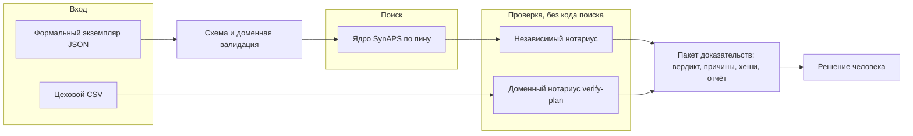

# SynAPS RepairFlow

> **Проверяемое планирование ремонта агрегатов: offline, воспроизводимо, fail-closed.**
> *Verifiable repair scheduling for units and aggregates: offline, reproducible, fail-closed.*

[](https://github.com/KonkovDV/SynAPS-RepairFlow/actions/workflows/ci.yml)
[](LICENSE)
[](https://github.com/astral-sh/ruff)
[](https://mypy.readthedocs.io/)
[](CITATION.cff)
[](docs/limitations.md)

**Русский** · [English](#english-version)

RepairFlow описывает ремонтную задачу депо или завода формальным экземпляром, строит кандидатный график на закреплённом ядре [SynAPS](https://github.com/KonkovDV/SynAPS) и отдельным кодом решает, можно ли назвать этот график проверенным. Если нельзя, программа возвращает причину по-русски, идентификаторы, интервал и подсказку, что ослабить.

> [!IMPORTANT]
> Это лабораторный эксперимент на синтетических данных. Человек принимает решение, программа его не подменяет. Данных заказчика здесь нет, внедрения нет, эффект не измерен. Если этот текст расходится с [`docs/limitations.md`](docs/limitations.md) или с таблицей доказательств, верны они.

# Русская версия

## Содержание

- [Зачем это нужно](#зачем-это-нужно)
- [Допустимое утверждение](#допустимое-утверждение)
- [Как читать вердикт](#как-читать-вердикт)
- [Быстрый старт](#быстрый-старт)
- [Рабочий цикл](#рабочий-цикл)
- [Как устроено](#как-устроено)
- [Что нотариус проверяет](#что-нотариус-проверяет)
- [Зафиксированная граница доказательств](#зафиксированная-граница-доказательств)
- [Место рядом с открытыми планировщиками](#место-рядом-с-открытыми-планировщиками)
- [Семейство репозиториев](#семейство-репозиториев)
- [Что не покрыто](#что-не-покрыто)
- [Разработка](#разработка)
- [Документы](#документы)
- [Цитирование, участие, безопасность, лицензия](#цитирование-участие-безопасность-лицензия)

## Зачем это нужно

План ремонта связан ограничениями сразу в нескольких местах: технологическая карта, пост, бригада с допуском, оснастка, наладка, календарь смен, запчасти и обменный фонд агрегатов. Решатель может вернуть график с хорошим makespan и при этом потерять операцию, нарушить допуск или вывести обменный фонд в минус. Если вердикт «допустимо» выносит тот же код, что искал расписание, его ошибка не видна.

RepairFlow разводит поиск и проверку. Ядро ищет слоты. Нотариус, который не импортирует код поиска, перепроверяет каждое назначение по исходному экземпляру и отказывает при любом сомнении. Короткий makespan не считается улучшением, если потеряно покрытие или появилось жёсткое нарушение.

## Допустимое утверждение

Для формального экземпляра RepairFlow строит кандидатный график и независимо сообщает, выполнены ли заявленные жёсткие ограничения, либо возвращает структурированные причины.

Это shadow-режим. Программа не диспетчеризует выпуск, не пишет в учётную систему и не подменяет контур безопасности. Сетевых вызовов во время работы нет.

## Как читать вердикт

| Слово | Когда оно честное |
| --- | --- |
| `verified` | Покрыты все операции, жёсткий нотариус пуст, статус ядра — `feasible` или `optimal`. |
| `domain_verified` | Цеховой CSV прошёл `repairflow verify-plan`. Ядро не вызывалось. `verified_feasible` остаётся ложным. |
| `optimal` | Точный прогон CP-SAT вернул `OPTIMAL` на исходной цепочке за один проход компилятора, и нотариус пуст. Эвристика это слово не наследует. |
| `rejected` | Любое жёсткое нарушение, неполное покрытие, недопустимость или неизвестный статус ядра. |

Код выхода повторяет вердикт, поэтому команду можно ставить в скрипт или CI.

| Код выхода | Смысл |
| --- | --- |
| ноль | Вердикт `verified`, `optimal` или `domain_verified`. Для `compare` — ни одно замороженное назначение не сломано. Для `demo` — все проверки готовности прошли. |
| два | Отказ с причинами: жёсткое нарушение, неполное покрытие, недопустимость, ошибка ядра или сломанное замороженное назначение. |
| один | Вход не прочитан, хеши не совпали при `check --verify-hashes`, команда вызвана неверно или `demo` не прошёл. |

## Быстрый старт

Версия Python — поле `requires-python` в [`pyproject.toml`](pyproject.toml). Установка подтягивает ядро SynAPS по полному SHA, дальше сеть не нужна.

```bash
python -m venv .venv
source .venv/bin/activate          # PowerShell: .venv\Scripts\Activate
python -m pip install -e ".[dev]"
repairflow version                 # версия RepairFlow и пин SynAPS
repairflow demo --out out          # последняя строка: MVP readiness: PASS
```

`demo` строит синтетический экземпляр, сравнивает FIFO и GREED, перепланирует после сбоя с замороженными назначениями, отдаёт нотариусу намеренно сломанный план и проверяет, что тот отвергнут. Без `--skip-cpsat` она ещё прогоняет CP-SAT на малом экземпляре. Если хоть одна проверка не прошла, команда завершается с кодом один.

## Рабочий цикл

```bash
repairflow synthesize --preset tiny --out out/tiny.json
repairflow solve out/tiny.json --out out/greed.json
repairflow solve out/tiny.json --preset FIFO --out out/fifo.json
repairflow check out/tiny.json out/greed.json --verify-hashes --report out/check.json
repairflow check out/tiny.json out/fifo.json      # отказ, среди причин CENTER_OVERLAP и SKILL_MISMATCH
repairflow compare out/tiny.json out/fifo.json out/greed.json --out out/diff.json
repairflow report out/tiny.json out/greed.json --md out/greed.md --html out/greed.html
```

| Команда | Что делает | Что остаётся на диске |
| --- | --- | --- |
| `synthesize` | Пишет синтетический экземпляр по пресету и seed. | JSON задачи по [схеме](schemas/repairflow.problem.v1.json). |
| `solve` | Строит кандидатный график выбранной конфигурацией и сразу проверяет его нотариусом. | JSON результата: назначения, вердикт, причины, хеши входа, результата и конфигурации. |
| `check` | Только нотариус: перепроверяет готовый план. С `--verify-hashes` сначала сверяет хеши. | Причины в stdout, отчёт по `--report`. |
| `verify-plan` | Доменный нотариус для цехового CSV по [шаблону](schemas/templates/shop-plan.csv). Ядро не вызывается. | Причины по-русски с идентификатором операции, результат по `--out`. |
| `compare` | Сравнивает два плана и ищет сломанные замороженные назначения. | JSON разницы по [схеме](schemas/repairflow.diff.v1.json). |
| `report` | Отчёт Markdown и HTML с диаграммой Ганта. | Файлы `--md` и `--html`. |
| `disrupt` | Локальное перепланирование после сбоя операции, остальное заморожено. | Новый JSON результата. |
| `inspect` | Дефектовка открывает ветку карты, остальные агрегаты заморожены. | Новый JSON результата. |
| `benchmark` | FIFO против GREED на матрице пресетов и seed. | `benchmark.json`, `.md`, `.html` и отчёты по экземплярам. |

## Как устроено



Нотариус не импортирует код поиска решателя. Опубликованный вердикт `verified` дополнительно читает проверку допустимости закреплённого SynAPS: независимость относится к поиску, не ко всей экосистеме ядра. `repairflow verify-plan` ядро не вызывает.

Инварианты нотариуса:

- Ёмкость `K` — это `K` взаимозаменяемых полос. Занятость — полуинтервал `[start, end)`: касание концов не есть пересечение.
- Наладка удлиняет занятость назад. В один момент окончание обрабатывается раньше начала. Тот же обход применяется к обычным и замороженным назначениям.
- Вердикт не зависит от порядка обхода множеств: стоки карты обменного фонда сортируются по идентификатору операции.
- Хеши входа, результата и конфигурации пишутся в каждый результат. `check --verify-hashes` отказывает при расхождении.

```text
false_accept_rate = invalid_plans_accepted_as_verified / invalid_plans_presented
```

Для фикстур оракула корректности цель — ноль принятых неверных планов. Оракул минут не судит обменный фонд. Расхождение оракула и нотариуса разбирается вручную, оракул под нотариус не подгоняется.

## Что нотариус проверяет

Схема отвергает неполный и неоднозначный вход. Дальше каждое назначение сверяется с исходным экземпляром. Полный список кодов и русских формулировок — [`src/repairflow/reasons.py`](src/repairflow/reasons.py).

| Ограничение | Коды причин |
| --- | --- |
| Покрытие и однозначность | `PARTIAL_COVERAGE`, `UNKNOWN_OPERATION`, `UNKNOWN_RESOURCE`, `DUPLICATE_ASSIGNMENT`, `JOB_MISMATCH` |
| Предшествование с лагами | `PRECEDENCE_BROKEN` |
| Посты | `CENTER_OVERLAP`, `ELIGIBLE_CENTER_MISMATCH` |
| Бригады и допуски | `CREW_OVERLAP`, `CREW_UNBOUND`, `AMBIGUOUS_CREW`, `SKILL_MISMATCH`, `SKILL_EXPIRED` |
| Календарь, окна, горизонт | `CALENDAR_BROKEN`, `WINDOW_BROKEN`, `HORIZON_VIOLATION`, `RELEASE_VIOLATION`, `INVALID_DURATION` |
| Оснастка и наладка | `AUX_OVERLAP`, `AUX_MISSING`, `MISSING_SETUP`, `SETUP_MISMATCH` |
| Запчасти и обменный фонд | `SPARE_UNAVAILABLE`, `EXCHANGE_POOL_STOCKOUT` |
| Замороженные назначения | `FROZEN_MOVED` |
| Сроки | `DEADLINE_MISSED` — жёсткий; `DUE_MISSED` — мягкий, показатель, не отказ |
| Статус ядра и компиляция | `KERNEL_STATUS_MISSING`, `KERNEL_STATUS_UNKNOWN`, `KERNEL_STATUS_NOT_FEASIBLE`, `DAG_FIXPOINT_NOT_CONVERGED`, `CPSAT_OPS_CAP` |

У каждой причины есть подсказка, что изменить: сдвинуть слот, выбрать другой пост, назначить бригаду с действующим допуском.

## Зафиксированная граница доказательств

Таблица между маркерами собрана `tools/attest.py` и аттестует только тот commit, чей собственный push CI на `main` прошёл успешно, включая `test-slow`. Проверка публичных страниц отвергает цифру вне неё. Слова «ноль» и «пусто» в этом файле — про цель оракула и коды выхода, не про новый замер.

<!-- evidence:begin -->
| Факт | Значение |
|---|---|
| Проверенный `main` | [`04ad612`](https://github.com/KonkovDV/SynAPS-RepairFlow/commit/04ad612851f1c39c96457a77cea03c358072f9a5) |
| CI для этого `main` | [Actions run 38563996424](https://github.com/KonkovDV/SynAPS-RepairFlow/actions/runs/38563996424), success, включая `test-slow` |
| Sweep-line commit | [`a3621fd`](https://github.com/KonkovDV/SynAPS-RepairFlow/commit/a3621fd538019f4dcc0c681d5634c022260382e9) |
| SynAPS pin | [`f939727`](https://github.com/KonkovDV/SynAPS/commit/f939727cd9369fd9b36438bfac7198f0c39c6d3b) |
| Solver | `ortools==9.15.6755` |
| Benchmark | [`benchmark/results/benchmark.json`](benchmark/results/benchmark.json), SHA-256 `c1a604c70ee6a8e99e52ecb9ac59341fabdf7c1a8771cdccf3dc836c605a2186`, claim `experiment` |
| Fault campaign | checked 10080, false_accept 0, false_reject 0, presets `tiny, repair-site-mvp`, solvers `GREED, EDD, ATC` |
| Манифест отстаёт от HEAD | да |
| Данные | committed synthetic fixtures; customer data отсутствуют |
| Зрелость | laboratory fixture / TRL 4; не pilot result |
<!-- evidence:end -->

Число без commit, provenance, seed, solver status, checker output и denominator не является доказательством. Машиночитаемая копия — [`docs/evidence-manifest.json`](docs/evidence-manifest.json), правила — [протокол доказательств](docs/evidence-protocol.md).

## Место рядом с открытыми планировщиками

RepairFlow не объявляет себя новым универсальным решателем. Вклад — доменный контракт, детерминированная компиляция в закреплённое ядро, независимый fail-closed нотариус, воспроизводимые хеши и теневой процесс с решением человека. Подробности и ссылки — в [обзоре](docs/literature-2026.md).

| Инструмент | Что даёт | Чем отличается RepairFlow |
| --- | --- | --- |
| [Timefold](https://github.com/TimefoldAI/timefold-quickstarts) | Решатель с жёстким и мягким счётом, пример планирования ТО. | Счёт там считает та же модель, по которой шёл поиск. Здесь отказ выносит отдельный код. Мягкий срок здесь тоже только показатель. |
| [OR-Tools CP-SAT](https://developers.google.com/optimization) | Точный решатель и статус `OPTIMAL` своей модели. | Статус ядра — вход нотариуса, не вердикт. `optimal` выдаётся только чистому прогону на исходной цепочке. |
| Учётная система ТОиР | Источник заказов, карт и остатков. | RepairFlow в неё не пишет. [Карта полей](docs/data-mapping-1c-toir.md) — не интеграция. |

## Семейство репозиториев

Публичные репозитории [KonkovDV](https://github.com/KonkovDV) рядом с этим. Их отчёты не переносятся сюда.

| Репозиторий | Роль | Что RepairFlow оттуда не берёт |
| --- | --- | --- |
| [SynAPS](https://github.com/KonkovDV/SynAPS) | Ядро поиска слотов. Именованные конфигурации решателя, воспроизводимый прогон, свой контроль допустимости. | Код ядра. Здесь только пин из таблицы доказательств. |
| [SynAPS-GridPlan](https://github.com/KonkovDV/SynAPS-GridPlan) | Лабораторное планирование ТОиР энергооборудования. Поиск и проверка разведены. | Другой домен, другой пин, другие отчёты. |
| [SynAPS-ProgramPlan](https://github.com/KonkovDV/SynAPS-ProgramPlan) | Сводный план программы: расчёт и вторая проверка, журнал решений с хеш-цепочкой. | Журнал оператора здесь ещё контракт, не цепочка записей. |
| [SynAPS-MobiRoute](https://github.com/KonkovDV/SynAPS-MobiRoute) | Планирование перевозки по вызову. | Не ремонт и не этот нотариус. |
| [AeroBIM](https://github.com/KonkovDV/AeroBIM) | Находка несёт пункт и идентификатор. Флаг годности ставит детерминированный контур, не текст модели. | Строительная проверка. Оттуда взята форма вердикта: код, идентификаторы, интервал. |
| [RailBreak](https://github.com/KonkovDV/RailBreak) | Подача для жюри: один запуск, таблица с источником, явный список того, что не покрыто. | Измерения одометрии. |

## Что не покрыто

- Нет записи в учётную систему, диспетчеризации, SCADA и функции безопасности.
- Нет утверждения о промышленном эффекте, действующем заказчике, спонсорстве или сертификации. Публичные страницы [программы пилотов](https://ftim.ru/pilotirovanie/), [профиля завода](https://www.mosgortrans.ru/about/branches/filial-sokolnicheskii-vagonoremontno-stroitelnyi-zavod-svarz-gup-mosgortrans/) и [кластера](https://i.moscow/pilot) задают ворота входа, а не факт внедрения.
- Маршрутные варианты не смоделированы.
- Журнал оператора — контракт без писателя.
- Нативная точная модель не начата: её открывает решение владельца, не этот README.
- CP-SAT в этой сборке вызывается только до лабораторного предела операций. Выше него точный прогон отвергается с `CPSAT_OPS_CAP`; такой экземпляр считают эвристики GREED, EDD или ATC.

Полный список — [`docs/limitations.md`](docs/limitations.md). Первый пилот, если он будет, остаётся теневым: один контур, обезличенный срез, согласованная база, журнал решений человека и откат. Ворота — [`docs/pilot-protocol.md`](docs/pilot-protocol.md).

## Разработка

```bash
python tools/verify_schema.py
python tools/export_schemas.py
python -m ruff format --check src tests tools
python -m ruff check src tests tools
python -m mypy --strict src/repairflow
python -m pytest -q -m "not slow"
python -m pytest -q -m slow          # то же, что задание test-slow в CI
```

CI запускает `lint`, `test-fast`, `synaps-pin`, `demo-evidence`, `benchmark` и `test-slow`. Задание `test-slow` идёт по расписанию, при ручном запуске, при push в `main` и на pull request с меткой `slow`. Мутационное тестирование модулей нотариуса идёт ночью по расписанию и по ручному запуску; разбор выживших мутантов — [`docs/mutation-survivors.md`](docs/mutation-survivors.md).

Правила проекта. Часть из них проверяют тесты и CI, остальное — ревью:

- Пин SynAPS — полный SHA. Каталог `synaps/` сюда не копируется.
- Нотариус не ослабляется, чтобы план прошёл. Оракул не подгоняется под нотариус.
- Публичные страницы не содержат фраз из [`docs/BANNED_CLAIMS.txt`](docs/BANNED_CLAIMS.txt). В этом README нет цифр вне таблицы доказательств.
- Таблицу доказательств меняет только `tools/attest.py` в отдельном pull request с документами.

## Документы

| Документ | О чём |
| --- | --- |
| [`docs/README.md`](docs/README.md) | Карта документации. |
| [`docs/MVP.md`](docs/MVP.md) | Точка входа MVP и команда готовности. |
| [`docs/domain-assumptions.md`](docs/domain-assumptions.md) | Доменные допущения: граница контура, карта как DAG, ресурсы. |
| [`docs/traceability-matrix.md`](docs/traceability-matrix.md) | Требование, код, тест. |
| [`docs/evidence-protocol.md`](docs/evidence-protocol.md) | Что считается доказательством. |
| [`docs/benchmark-protocol.md`](docs/benchmark-protocol.md) | Как устроен бенчмарк и что он не утверждает. |
| [`docs/threat-model.md`](docs/threat-model.md) | Модель угроз. |
| [`docs/murder-board.md`](docs/murder-board.md) | Неудобные вопросы и прямые ответы. |
| [`docs/osint-and-pilot-gates.md`](docs/osint-and-pilot-gates.md) | Открытые источники и ворота пилота. |
| [`docs/adr/`](docs/adr/) | Архитектурные решения. |
| [`APPLICATION.md`](APPLICATION.md) | Пакет для конкурса или акселератора, не договор. |
| [`CHANGELOG.md`](CHANGELOG.md) | История изменений. |

## Цитирование, участие, безопасность, лицензия

- Цитирование — метаданные в [`CITATION.cff`](CITATION.cff); GitHub показывает кнопку «Cite this repository».
- Участие — [`CONTRIBUTING.md`](CONTRIBUTING.md). Pull request называет синтетическую фикстуру, путь решателя и пуст ли нотариус.
- Уязвимости — через GitHub Security Advisories, см. [`SECURITY.md`](SECURITY.md). Выгрузки депо и учётные данные в issue не публикуются.
- Лицензия MIT, если файл не говорит иного; лицензии закреплённых зависимостей — [`LICENSES.md`](LICENSES.md).

Этот текст — инженерное описание, не договор, не обоснование безопасности и не сертификат готовности.

---

# English version

- [Why](#why)
- [Allowed claim](#allowed-claim)
- [How to read a verdict](#how-to-read-a-verdict)
- [Quick start](#quick-start)
- [Working cycle](#working-cycle)
- [Architecture](#architecture)
- [What the notary checks](#what-the-notary-checks)
- [Evidence boundary](#evidence-boundary)
- [Next to open schedulers](#next-to-open-schedulers)
- [Repository family](#repository-family)
- [Not covered](#not-covered)
- [Development](#development)
- [Cite, contribute, report, license](#cite-contribute-report-license)

## Why

A repair plan is bound in several places at once: the routing card, the post, a crew with a valid skill, tooling, setup, the shift calendar, spares, and the exchange pool of units. A solver can return a schedule with a good makespan and still drop an operation, break a skill rule, or drive the exchange pool below zero. When the code that searched also declares the schedule feasible, its mistake stays hidden.

RepairFlow separates search from checking. The kernel searches for slots. A notary that does not import search code rechecks every assignment against the original instance and refuses on any doubt. A shorter makespan is not an improvement when coverage is incomplete or a hard violation appears.

## Allowed claim

Given a formal repair instance, RepairFlow builds a candidate schedule and independently reports whether the declared hard constraints hold, or returns structured reasons.

The mode is shadow. A person decides. The program does not dispatch vehicles, write back to an enterprise system, or replace a safety controller. It makes no network calls at run time.

## How to read a verdict

| Word | When it is honest |
| --- | --- |
| `verified` | Every operation is covered, the hard notary is empty, and the kernel status is `feasible` or `optimal`. |
| `domain_verified` | A shop CSV passed `repairflow verify-plan`. The kernel was not called. `verified_feasible` stays false. |
| `optimal` | An exact CP-SAT run returned `OPTIMAL` on the original chain in one compiler pass, and the notary is empty. A heuristic does not inherit the word. |
| `rejected` | Any hard violation, incomplete coverage, infeasibility, or an unknown kernel status. |

The exit code mirrors the verdict, so a command can gate a script or a CI job.

| Exit code | Meaning |
| --- | --- |
| zero | `verified`, `optimal`, or `domain_verified`. For `compare`, no frozen assignment broke. For `demo`, every readiness check passed. |
| two | Refused with reasons: a hard violation, incomplete coverage, infeasibility, a kernel error, or a broken frozen assignment. |
| one | Unreadable input, a hash mismatch under `check --verify-hashes`, a usage error, or a failed `demo`. |

## Quick start

The Python version is the `requires-python` field of [`pyproject.toml`](pyproject.toml). Installation fetches the SynAPS kernel by full SHA. Nothing after that needs the network.

```bash
python -m venv .venv
source .venv/bin/activate          # PowerShell: .venv\Scripts\Activate
python -m pip install -e ".[dev]"
repairflow version                 # RepairFlow version and SynAPS pin
repairflow demo --out out          # last line: MVP readiness: PASS
```

`demo` builds a synthetic instance, compares FIFO with GREED, replans after a disruption with frozen assignments, hands an intentionally broken plan to the notary, and checks that it is refused. Without `--skip-cpsat` it also runs CP-SAT on a small instance. If any check fails, the command exits with code one.

## Working cycle

```bash
repairflow synthesize --preset tiny --out out/tiny.json
repairflow solve out/tiny.json --out out/greed.json
repairflow solve out/tiny.json --preset FIFO --out out/fifo.json
repairflow check out/tiny.json out/greed.json --verify-hashes --report out/check.json
repairflow check out/tiny.json out/fifo.json      # refused, among the reasons CENTER_OVERLAP and SKILL_MISMATCH
repairflow compare out/tiny.json out/fifo.json out/greed.json --out out/diff.json
repairflow report out/tiny.json out/greed.json --md out/greed.md --html out/greed.html
```

| Command | What it does | What it leaves on disk |
| --- | --- | --- |
| `synthesize` | Writes a synthetic instance for a preset and seed. | Problem JSON under the [schema](schemas/repairflow.problem.v1.json). |
| `solve` | Builds a candidate with the chosen config and runs the notary on it. | Result JSON: assignments, verdict, reasons, input, result, and config hashes. |
| `check` | Notary only, on an existing plan. `--verify-hashes` compares hashes first. | Reasons on stdout, a report with `--report`. |
| `verify-plan` | Domain notary for a shop CSV built from the [template](schemas/templates/shop-plan.csv). The kernel is not called. | Russian reasons with the operation id, a result with `--out`. |
| `compare` | Diffs two plans and looks for broken frozen assignments. | Diff JSON under the [schema](schemas/repairflow.diff.v1.json). |
| `report` | Markdown and an HTML Gantt chart. | The `--md` and `--html` files. |
| `disrupt` | Local replan after an operation fails; everything else stays frozen. | A new result JSON. |
| `inspect` | An inspection opens a branch of the card; other units stay frozen. | A new result JSON. |
| `benchmark` | FIFO versus GREED over a preset and seed matrix. | `benchmark.json`, `.md`, `.html`, and per-instance reports. |

## Architecture

The diagram is in the [Russian section](#как-устроено). The flow is: formal instance, schema and domain validation, the pinned SynAPS kernel, the independent notary, an evidence bundle, a human decision. A shop CSV goes straight to the domain notary.

The notary does not import solver search code. A published `verified` verdict also reads the pinned SynAPS feasibility check: independence is about search, not about the whole kernel ecosystem. `repairflow verify-plan` does not call the kernel.

Notary invariants:

- Capacity `K` is `K` interchangeable lanes. Occupancy is half-open, `[start, end)`, so touching endpoints do not overlap.
- Setup extends occupancy backwards. At one instant an end is processed before a start. The same sweep covers ordinary and frozen assignments.
- A verdict does not depend on set iteration order: exchange-pool sinks are sorted by operation id.
- Input, result, and config hashes are written into every result. `check --verify-hashes` refuses on a mismatch.

```text
false_accept_rate = invalid_plans_accepted_as_verified / invalid_plans_presented
```

For correctness-oracle fixtures the target is zero accepted invalid plans. The minute oracle does not judge the exchange-pool ledger. When the oracle and the notary disagree, the case is read by hand. The oracle is not fitted to the notary.

## What the notary checks

The schema rejects an incomplete or ambiguous input. Every assignment is then checked against the original instance: coverage and identity, precedence with lags, posts, crews and skill validity, calendars, windows and the horizon, tooling and setup, spares and the exchange pool, frozen assignments, a hard deadline versus a soft due date, and the kernel status. The reason-code table is in the [Russian section](#что-нотариус-проверяет), and the full catalogue with Russian wording is [`src/repairflow/reasons.py`](src/repairflow/reasons.py). Every reason carries a suggested relaxation.

## Evidence boundary

The only generated table is in the Russian section above, between the evidence markers. `tools/attest.py` writes it, and it attests only a commit whose own push CI on `main` succeeded, including `test-slow`. The public-page check rejects a digit outside it. The words "zero" and "empty" on this page name the oracle target and exit codes, not a fresh measurement.

A number without a commit, provenance, seed, solver status, checker output, and a denominator is not evidence. The machine-readable copy is [`docs/evidence-manifest.json`](docs/evidence-manifest.json), and the rules are the [evidence protocol](docs/evidence-protocol.md).

## Next to open schedulers

RepairFlow does not present itself as a new general-purpose solver. The contribution is the domain contract, deterministic compilation into a pinned engine, an independent fail-closed notary, reproducible hashes, and a human-reviewed shadow workflow. See the [literature review](docs/literature-2026.md).

| Tool | What it gives | How RepairFlow differs |
| --- | --- | --- |
| [Timefold](https://github.com/TimefoldAI/timefold-quickstarts) | A solver with hard and soft scores and a maintenance-scheduling quickstart. | Its score comes from the same constraint model that drove search. Here separate code refuses. A soft due date is a KPI here too. |
| [OR-Tools CP-SAT](https://developers.google.com/optimization) | An exact solver and an `OPTIMAL` status for its own model. | The kernel status is an input to the notary, not the verdict. `optimal` goes only to a clean run on the original chain. |
| A maintenance enterprise system | The source of orders, cards, and stock. | RepairFlow does not write to it. The [field map](docs/data-mapping-1c-toir.md) is not an integration. |

## Repository family

Public repositories under [KonkovDV](https://github.com/KonkovDV) sit beside this one. Their reports are not RepairFlow evidence.

| Repository | Role | What RepairFlow does not import |
| --- | --- | --- |
| [SynAPS](https://github.com/KonkovDV/SynAPS) | Slot search. Named solver configs, a reproducible run, its own feasibility check. | The kernel source. This repo keeps the pin in the evidence table. |
| [SynAPS-GridPlan](https://github.com/KonkovDV/SynAPS-GridPlan) | Laboratory maintenance scheduling for power equipment. Search and checking are separate. | A different domain, pin, and report set. |
| [SynAPS-ProgramPlan](https://github.com/KonkovDV/SynAPS-ProgramPlan) | A programme plan with a second check and a hash-chained decision log. | The operator log here is still a contract, not a hash chain. |
| [SynAPS-MobiRoute](https://github.com/KonkovDV/SynAPS-MobiRoute) | Dial-a-ride planning. | Not repair, and not this notary. |
| [AeroBIM](https://github.com/KonkovDV/AeroBIM) | A finding carries a clause and an identifier. A deterministic gate sets the pass flag. | Construction review. The borrowed idea is the shape of a verdict: code, identifiers, interval. |
| [RailBreak](https://github.com/KonkovDV/RailBreak) | A jury packet: one run, a sourced table, an explicit uncovered list. | Odometry measurements. |

## Not covered

- There is no write-back, dispatch, SCADA, or safety function.
- There is no claim of an industrial effect, a live customer, sponsorship, or a certificate. The public pages of the [pilot programme](https://ftim.ru/pilotirovanie/), the [plant profile](https://www.mosgortrans.ru/about/branches/filial-sokolnicheskii-vagonoremontno-stroitelnyi-zavod-svarz-gup-mosgortrans/), and the [innovation cluster](https://i.moscow/pilot) are entry gates, not a deployment record.
- Route variants are not modelled.
- The operator log is a contract without a writer.
- The native exact model has not been started: an owner decision opens it, not this page.
- CP-SAT is called only up to a laboratory operation cap in this build. Above it the exact run is refused with `CPSAT_OPS_CAP`; such an instance goes to the GREED, EDD, or ATC heuristics.

The full list is [`docs/limitations.md`](docs/limitations.md). A first pilot, if one happens, stays in shadow: one contour, an anonymised slice, an agreed baseline, a human decision log, and rollback. The gates are [`docs/pilot-protocol.md`](docs/pilot-protocol.md).

## Development

The quality gates are the commands in the [Russian section](#разработка). CI runs `lint`, `test-fast`, `synaps-pin`, `demo-evidence`, `benchmark`, and `test-slow`. `test-slow` runs on schedule, on manual dispatch, on push to `main`, and on a pull request labelled `slow`. Mutation testing of the notary modules runs nightly on schedule and on manual dispatch; the survivor review is [`docs/mutation-survivors.md`](docs/mutation-survivors.md).

Project rules. Tests and CI enforce some of them, review enforces the rest:

- The SynAPS pin is a full SHA. The `synaps/` tree is not copied here.
- The notary is not weakened to let a plan pass. The oracle is not fitted to the notary.
- Public pages carry no phrase from [`docs/BANNED_CLAIMS.txt`](docs/BANNED_CLAIMS.txt). This README has no digits outside the evidence table.
- Only `tools/attest.py`, in a separate docs-only pull request, changes the evidence table.

## Cite, contribute, report, license

- Cite with [`CITATION.cff`](CITATION.cff); GitHub shows a "Cite this repository" button.
- Contribute through [`CONTRIBUTING.md`](CONTRIBUTING.md). A pull request names the synthetic fixture, the solver path, and whether the notary is empty.
- Report vulnerabilities through GitHub Security Advisories, see [`SECURITY.md`](SECURITY.md). Do not post depot dumps or credentials in an issue.
- MIT, unless a file says otherwise; the licences of the pinned dependencies are in [`LICENSES.md`](LICENSES.md).

This page is an engineering description, not a contract, a safety case, or a readiness certificate.
