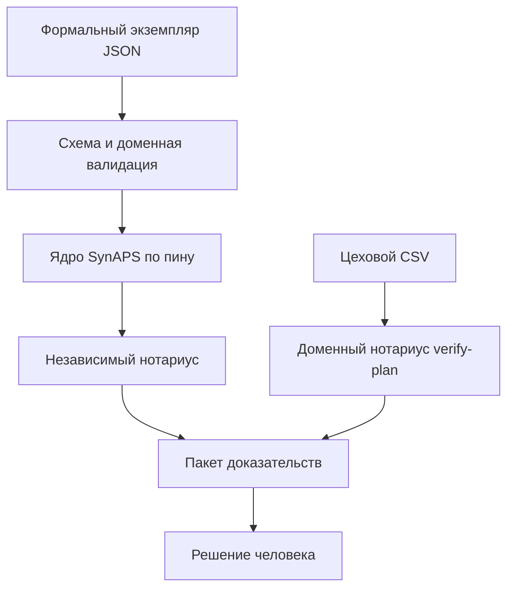

# SynAPS RepairFlow

Календарное планирование ремонта узлов и агрегатов с независимой проверкой допустимости.

В ремонтном производстве план связан сразу по нескольким контурам: после разборки технологическая карта расходится на параллельные ветки восстановления узлов и снова сходится на общей сборке, посты требуют переналадки между состояниями, бригады ограничены квалификационными допусками и графиками смен, оснастка и стенды делятся между постами, а выпуск операции зависит от прихода расходных деталей, возврата оборотных узлов и остатка в обменном фонде.

Построение расписания и его проверка в RepairFlow разделены. Слоты ищет ядро [SynAPS](https://github.com/KonkovDV/SynAPS) или доменный списочный планировщик, а готовый план заново проверяет отдельный нотариус (`repairflow.checker`), не вызывающий код поиска. Если расписание нарушает хотя бы одно жёсткое правило или оставляет операцию без назначения, план отклоняется с кодом причины, русским пояснением, затронутыми объектами и интервалом времени.

Это лабораторный стенд на синтетических данных. Программа считает без обращения к сети, работает в теневом режиме и не подаёт команд производственным или учётным системам — решение остаётся за человеком. Если формулировка на странице расходится с [`docs/limitations.md`](docs/limitations.md) или с таблицей проверенной ревизии ниже, приоритет у них.

[](https://github.com/KonkovDV/SynAPS-RepairFlow/actions/workflows/ci.yml)
[](LICENSE)

Значок сборки показывает состояние последнего прогона на GitHub Actions; сведения об аттестованной ревизии приведены в разделе «Проверенная ревизия и замеры».

## Содержание

- [Зачем разведены расчёт и проверка](#зачем-разведены-расчёт-и-проверка)
- [Что умеет система](#что-умеет-система)
- [Как читать вердикт и код выхода](#как-читать-вердикт-и-код-выхода)
- [Быстрый старт и демонстрационный прогон](#быстрый-старт-и-демонстрационный-прогон)
- [Рабочий цикл и команды](#рабочий-цикл-и-команды)
- [Как устроена независимая проверка](#как-устроена-независимая-проверка)
- [Справочник кодов отказа](#справочник-кодов-отказа)
- [Проверенная ревизия и замеры](#проверенная-ревизия-и-замеры)
- [Смежные решения и соседние репозитории](#смежные-решения-и-соседние-репозитории)
- [Границы текущей сборки](#границы-текущей-сборки)
- [Разработка и проверка перед отправкой изменений](#разработка-и-проверка-перед-отправкой-изменений)
- [Документация](#документация)
- [English](#english)

## Зачем разведены расчёт и проверка

Когда расписание ремонта собирают вручную или проверяют тем же кодом, который искал слоты, часть конфликтов всплывает уже в цехе. Короткий по длительности график может потерять операцию сходящейся ветки, поставить бригаду с истёкшим допуском, пропустить время переналадки поста или увести обменный фонд агрегатов в дефицит. Если пригодность плана подтверждает сам решатель, ошибка в его модели или эвристике остаётся незамеченной.

RepairFlow закрывает этот разрыв:

- любой график — построенный через ядро SynAPS, полученный быстрой доменной эвристикой, пересчитанный после цехового сбоя или загруженный из внешней таблицы CSV — проходит через отдельный проверочный контур;
- сокращение общего срока ремонта не считается улучшением, если потеряна хотя бы одна операция или нарушено жёсткое ограничение;
- каждый план запечатывается криптографическими отпечатками исходной задачи, настроек и расписания, поэтому подмена дат в готовом файле обнаруживается при проверке;
- решение планировщика или диспетчера фиксируется в журнале с цепочкой хешей: задним числом изменить или удалить запись незаметно нельзя.

## Что умеет система

| Контур задачи | Как он реализован в RepairFlow |
| --- | --- |
| **Сходящиеся технологические карты** | Заказ может задавать произвольный ациклический граф предшествования: разборка расходится на параллельные ветки, сборка ждёт завершения каждой. Компилятор раскладывает граф в цепочки для ядра с окнами выпуска, а доменный нотариус проверяет все исходные рёбра и задержки напрямую. |
| **Посты, полосы и переналадка** | У каждого поста заданы параллельные полосы и матрица переналадки между технологическими состояниями. Время переналадки зависит от предыдущего состояния на конкретной полосе и входит в интервал занятости. |
| **Бригады, допуски и оснастка** | В опубликованном плане на каждую операцию с требованиями к квалификации назначается конкретная бригада (`crew_id`), чей допуск действует до конца операции. Одновременно проверяются сменные календари постов, бригад и вспомогательной оснастки. |
| **Запчасти и обменный фонд** | Расходные детали с графиком поставок могут блокировать старт операции, оборотные узлы учитывают время возврата после завершения работы, а обменный фонд ведётся отдельной книгой остатков по моментам списания и пополнения. |
| **Цеховые сбои и дефектовка** | Поддерживается пересчёт при остановке поста, задержке поставки детали, невыходе бригады, увеличении длительности операции и появлении срочного заказа. Не затронутые сбоем назначения в замороженном окне сохраняются. Команда `inspect` добавляет вскрытую при дефектовке ветку работ без сдвига уже выданных слотов. |
| **Проверка внешнего цехового плана** | Команда `verify-plan` проверяет готовый график из таблицы CSV по [шаблону](schemas/templates/shop-plan.csv) без запуска ядра и указывает в отчёте файл, номер строки и причину каждого конфликта. |
| **Объяснение отказа и журнал оператора** | Для отклонённого плана выделяется минимальный по удалению набор операций, воспроизводящий доменный конфликт. Команды `decide` и `log` ведут проверяемый журнал решений человека с возможностью внешнего заверения вершины по HMAC. |

## Как читать вердикт и код выхода

У каждого проверенного расписания один итоговый статус (`claim_status`), от которого зависит допустимость публикации:

| Статус в отчёте | Когда он выставляется |
| --- | --- |
| `verified` | Назначены все операции задачи, жёстких нарушений у нотариуса нет, а статус ядра равен `feasible` или `optimal`. |
| `domain_verified` | Внешний цеховой план из CSV прошёл доменную проверку `repairflow verify-plan` без замечаний. Ядро при этом не вызывалось, поэтому поле `verified_feasible` остаётся ложным. |
| `optimal` | Решатель CP-SAT доказал статус `OPTIMAL` на исходной цепочке за один проход компилятора, и независимый нотариус не нашёл нарушений. Эвристики этот статус не получают. |
| `rejected` | Найдено хотя бы одно жёсткое нарушение, не все операции получили слоты, задача невыполнима или статус ядра не подтверждает допустимость. |

Код завершения команды однозначно отражает этот итог и подходит для автоматических проверок в скриптах:

| Код выхода | Значение |
| --- | --- |
| ноль | План получил статус `verified`, `optimal` или `domain_verified`. Для `compare` — ни одно замороженное назначение не сдвинуто. Для `demo` — все проверки стенда прошли успешно. |
| два | План отклонён по правилам домена: жёсткое нарушение, неполное покрытие, невыполнимость, неподтверждённый статус ядра или сдвиг замороженного слота. |
| один | Входной файл не прочитан или не прошёл схему, не сошлись отпечатки при `check --verify-hashes`, неверно заданы аргументы или сорвалась проверка готовности `demo`. |

## Быстрый старт и демонстрационный прогон

Требуемая версия интерпретатора Python указана в поле `requires-python` файла [`pyproject.toml`](pyproject.toml). При установке пакет подключает ядро SynAPS по закреплённому коммиту; после установки сеть для работы не нужна.

```bash
python -m venv .venv
source .venv/bin/activate          # PowerShell: .venv\Scripts\Activate
python -m pip install -e ".[dev]"
repairflow version
repairflow demo --out out
```

Команда `repairflow demo --out out` за один прогон разворачивает в каталоге `out/` полный демонстрационный стенд на синтетическом ремонтном участке:

- строит задачу `repair-site-mvp.json` и сравнивает на ней наивную очередь FIFO (`fifo.json`, отвергается нотариусом из-за наложений на постах, конфликтов бригад и несоответствия допусков) с жадным планировщиком GREED (`greed.json`, проходит все проверки со статусом `verified`);
- без флага `--skip-cpsat` запускает точный решатель CP-SAT на компактном срезе (`cpsat.json`);
- моделирует внеплановый выход поста из строя (`post-down.json`), фиксирует нарушение `CALENDAR_BROKEN` на прежнем плане и перестраивает расписание (`replan.json`, `replan-diff.json`) без сдвига замороженных работ;
- подаёт нотариусу намеренно испорченный план (`broken.json`), убеждается в отказе и выделяет в `witness.json` минимальный по удалению набор конфликтующих операций;
- проверяет внешний цеховой лист `shop-plan.csv` через доменный контур без вызова ядра (`shop-verify.json`, `shop-reasons.txt`) с привязкой ошибки к строке файла;
- записывает принятие плана `greed.json` в журнал оператора `decisions.jsonl` и проверяет целостность хеш-цепочки.

Если все этапы прошли штатно, прогон завершается строкой `MVP readiness: PASS` и нулевым кодом выхода. Порядок показа на защите описан в [`docs/jury-demo.md`](docs/jury-demo.md), а сборка автономного контейнера с корневой файловой системой только для чтения — в [`docs/runbook.md`](docs/runbook.md).

## Рабочий цикл и команды

Типовой сценарий работы с отдельным экземпляром задачи из командной строки:

```bash
repairflow synthesize --preset tiny --out out/tiny.json
repairflow solve out/tiny.json --out out/greed.json
repairflow solve out/tiny.json --preset FIFO --out out/fifo.json
repairflow check out/tiny.json out/greed.json --verify-hashes --report out/check.json
repairflow check out/tiny.json out/fifo.json
repairflow compare out/tiny.json out/fifo.json out/greed.json --out out/diff.json
repairflow report out/tiny.json out/greed.json --md out/greed.md --html out/greed.html
```

Все команды пакета `repairflow`:

| Команда | Назначение | Выходные файлы и результат |
| --- | --- | --- |
| `synthesize` | Сгенерировать синтетический экземпляр ремонтного участка по пресету и зерну `--seed`. | Файл задачи в формате JSON по [схеме задачи](schemas/repairflow.problem.v1.json). |
| `solve` | Построить расписание выбранным решателем (`GREED`, `FIFO`, `EDD`, `ATC`, `CPSAT-*`) и сразу проверить его нотариусом. | JSON по [схеме результата](schemas/repairflow.result.v1.json): назначения, вердикт, нарушения и хеши. |
| `check` | Перепроверить готовый план нотариусом. С флагом `--verify-hashes` предварительно сверяются отпечатки входа, настроек и расписания. | Список нарушений в консоли и полный отчёт в файле `--report`. |
| `verify-plan` | Проверить внешний цеховой план из таблицы CSV по [шаблону](schemas/templates/shop-plan.csv) без обращения к ядру. | Русские формулировки причин с номерами строк CSV и JSON-отчёт в `--out`. |
| `compare` | Сопоставить два расписания одной задачи, оценить сдвиги и проверить сохранность замороженных назначений. | Отчёт сравнения в формате JSON по [схеме разницы](schemas/repairflow.diff.v1.json). |
| `report` | Собрать читаемую сводку и интерактивную диаграмму Ганта по задаче и плану. | Текстовый отчёт `--md` и автономная страница `--html`. |
| `disrupt` | Перестроить график после сбоя (поломка поста, задержка детали, невыход бригады, удлинение работы, срочный заказ) при заморозке незатронутых слотов. | Обновлённый JSON результата с пересчитанным вердиктом нотариуса. |
| `inspect` | Включить в заказ вскрытую при дефектовке ветку операций, сохранив все ранее выданные слоты замороженными. | Новый JSON результата после доменного достроения и проверки. |
| `benchmark` | Сравнить решатели на наборе пресетов и зёрен с едиными метриками и проверкой каждого плана. | Сводные таблицы `benchmark.json`, `benchmark.md`, `benchmark.html` и отчёты по примерам. |
| `decide` | Зафиксировать решение оператора (`accept`, `accept-with-edits`, `reject`, `manual-fallback`) по проверенным файлам задачи и плана. Принять отклонённый план нельзя. | Новая запись в журнале JSONL, связанная хешем с предыдущей. |
| `log verify` | Пересчитать хеш-цепочку журнала решений и при переданной вершине `--head` или HMAC `--witness` убедиться, что хвост файла не урезан и не переписан. | Код завершения проверки. |
| `log witness` | Вычислить HMAC-отпечаток текущей вершины журнала внешним ключом из файла `--key-file`. | Строка шестнадцатеричного дайджеста для хранения вне журнала. |
| `log stats` | Вывести сводную долю принятых, исправленных и отклонённых планов и частые причины отказа без раскрытия кодов операторов. | Статистика в консоли. |

## Как устроена независимая проверка



Для статуса `verified` план должен пройти и проверку допустимости закреплённого ядра SynAPS, и независимый доменный нотариус RepairFlow (`checker.py`). Независимость нотариуса означает полное отделение от алгоритмов поиска и диспетчеризации (`planner.py`, `synaps.solvers`). При проверке внешнего цехового листа через `repairflow verify-plan` работает только доменный контур.

Когда расписание строилось через ядро, нотариус прежде всего убеждается, что переданная ядру задача совпадает с тем, что компилятор собрал из исходного экземпляра `RepairFlowProblem`. Любая подмена идентификатора, оборванная ссылка или расхождение параметров отклоняется кодом `INVALID_ID_MAP`:

| Контур сверки | Что именно проверяется |
| --- | --- |
| **Набор объектов** | Взаимно-однозначное соответствие операций, рабочих постов, заказов, технологических состояний, бригад, оснастки и пулов навыков. Одного совпадения количества операций недостаточно. |
| **Замкнутость ссылок** | Каждая ссылка на заказ, состояние, предшественника, допустимый пост, ячейку матрицы переналадки и требование к ресурсу должна указывать только на объекты внутри карты идентификаторов. Собственный идентификатор строки переналадки ключом карты не служит. |
| **Операции** | Базовая длительность, крайний срок завершения, состояние переналадки, упорядоченный список допустимых постов, принадлежность ремонтному заказу и требуемые навыки. Переопределения длительности по конкретному посту должны отсутствовать. |
| **Заказы** | Дата выпуска, плановый срок (или конец горизонта, если срок не задан), приоритет, внешняя ссылка, код актива и тип ремонтируемого узла. Объём заказа в ядре не переопределяется. |
| **Посты, бригады и оснастка** | Параллельность постов, численность бригад, ёмкость оснастки, размер пулов навыков, коды, группы возможностей, квалификации, типы ресурсов и интервалы смен совпадают с тем, что формирует компилятор. Скорость поста остаётся штатной. |
| **Матрица переналадки и запросы ресурсов** | Длительность каждого перехода совпадает с независимым расчётом нотариуса, а побочные потери материала и энергии равны нулю. Каждое требование к вспомогательному ресурсу указывает на оснастку операции, единственную подходящую бригаду или соответствующий пул навыков. |
| **Горизонт планирования** | Начало и окончание горизонта в задаче ядра совпадают с горизонтом исходной ремонтной задачи. |

При этой сверке нотариус не пересобирает заново внутренние рёбра внутри скомпилированного отрезка цепочки, расчётный ранний старт и служебный идентификатор отрезка: исходные рёбра технологической карты и времена выпуска он проверяет напрямую по доменной модели. Календарь ресурса с персоналом, в котором нет ни одного рабочего окна, компилятор представляет в структуре ядра пустым списком, а запрет работы на таком ресурсе фиксирует доменный нотариус.

Базовые правила, на которых стоит проверка расписания:

- **Полуинтервалы и полосы.** Ресурс ёмкости `K` моделируется как `K` параллельных полос. Занятость задаётся полуинтервалом `[start, end)`: если одна операция заканчивается в ту же минуту, когда начинается следующая, наложения нет.
- **Переналадка внутри занятости.** Интервал переналадки от предыдущего состояния полосы примыкает к началу обработки. При разборе событий в одну и ту же минуту освобождение ресурса всегда обрабатывается раньше нового занятия, а обычные и замороженные назначения проходят через единый алгоритм развёртки.
- **Детерминизм.** Результат проверки не зависит от порядка обхода множеств в памяти: стоки технологических карт в книге обменного фонда и события прихода-расхода запчастей строго упорядочены по ключу операции.
- **Неизменяемость отпечатков.** В каждый отчёт записываются `input_hash`, `config_hash`, платформонезависимый `schedule_hash` и полный `result_hash`. Вызов `check --verify-hashes` отвергает файл, если расписание или входные данные изменились после расчёта.

```text
false_accept_rate = invalid_plans_accepted_as_verified / invalid_plans_presented
```

Правильность самого нотариуса проверяется независимым поминутным оракулом (`tests/oracle_minutes.py`) на матрице намеренно испорченных планов: ни один заведомо недопустимый график не должен получить статус `verified` (доля ложного приёма равна нулю). Книга обменного фонда оценивается отдельными тестами вне поминутного оракула. При любом расхождении между оракулом и нотариусом разбирается конкретный пример — оракул под нотариус не подгоняется.

## Справочник кодов отказа

Сначала входная схема отсекает синтаксически неполные или противоречивые данные. Затем нотариус проверяет каждое назначение и формирует список нарушений. Полный перечень кодов, русских формулировок и подсказок по устранению (`suggested_relaxation`) находится в [`src/repairflow/reasons.py`](src/repairflow/reasons.py):

| Группа правил | Коды нарушений |
| --- | --- |
| Покрытие и однозначность ссылок | `PARTIAL_COVERAGE`, `UNKNOWN_OPERATION`, `UNKNOWN_RESOURCE`, `DUPLICATE_ASSIGNMENT`, `JOB_MISMATCH` |
| Порядок операций и задержки | `PRECEDENCE_BROKEN` |
| Рабочие посты | `CENTER_OVERLAP`, `ELIGIBLE_CENTER_MISMATCH` |
| Бригады и квалификационные допуски | `CREW_OVERLAP`, `CREW_UNBOUND`, `AMBIGUOUS_CREW`, `SKILL_MISMATCH`, `SKILL_EXPIRED` |
| Сменные календари, окна и горизонт | `CALENDAR_BROKEN`, `WINDOW_BROKEN`, `HORIZON_VIOLATION`, `RELEASE_VIOLATION`, `INVALID_DURATION` |
| Вспомогательная оснастка и переналадка | `AUX_OVERLAP`, `AUX_MISSING`, `MISSING_SETUP`, `SETUP_MISMATCH` |
| Запчасти и обменный фонд | `SPARE_UNAVAILABLE`, `EXCHANGE_POOL_STOCKOUT` |
| Сохранность замороженного плана | `FROZEN_MOVED` |
| Выполнение сроков | `DEADLINE_MISSED` (жёсткий отказ), `DUE_MISSED` (мягкий показатель просрочки, не отменяет допустимость) |
| Статус ядра и компиляция модели | `KERNEL_STATUS_MISSING`, `KERNEL_STATUS_UNKNOWN`, `KERNEL_STATUS_NOT_FEASIBLE`, `DAG_FIXPOINT_NOT_CONVERGED`, `CPSAT_OPS_CAP`, `INVALID_ID_MAP` |

## Проверенная ревизия и замеры

Таблица ниже формируется автоматически скриптом `tools/attest.py` из файла [`docs/evidence-manifest.json`](docs/evidence-manifest.json). В неё попадает только та ревизия ветки `main`, чей собственный прогон CI после слияния прошёл целиком, включая полный набор `test-slow`. Расширенная сводка для пакета подачи собирается отдельно в [`docs/submission-facts.md`](docs/submission-facts.md).

<!-- evidence:begin -->
| Факт | Значение |
|---|---|
| Проверенный `main` | [`09562da`](https://github.com/KonkovDV/SynAPS-RepairFlow/commit/09562dad6af918b3e0f5ff78e93880884626fa98) |
| CI для этого `main` | [Actions run 39115444866](https://github.com/KonkovDV/SynAPS-RepairFlow/actions/runs/39115444866), success, включая `test-slow` |
| Sweep-line commit | [`a3621fd`](https://github.com/KonkovDV/SynAPS-RepairFlow/commit/a3621fd538019f4dcc0c681d5634c022260382e9) |
| SynAPS pin | [`f939727`](https://github.com/KonkovDV/SynAPS/commit/f939727cd9369fd9b36438bfac7198f0c39c6d3b) |
| Solver | `ortools==9.15.6755` |
| Benchmark | [`benchmark/results/benchmark.json`](benchmark/results/benchmark.json), SHA-256 `5cccd7d9045d36ca1d920f291f3263d2ed311685db79adf12c9769f14324b381`, claim `experiment` |
| Fault campaign | checked 10080, false_accept 0, false_reject 0, presets `tiny, repair-site-mvp`, solvers `GREED, EDD, ATC` |
| Манифест отстаёт от HEAD | да |
| Данные | committed synthetic fixtures; customer data отсутствуют |
| Зрелость | laboratory fixture / TRL 4; не pilot result |
<!-- evidence:end -->

Любой количественный результат в проекте публикуется только вместе с ревизией кода, происхождением данных, зерном генератора, именем решателя, вердиктом нотариуса и размером выборки. Правила оформления замеров и лестница доказательств изложены в [`docs/evidence-protocol.md`](docs/evidence-protocol.md).

## Смежные решения и соседние репозитории

RepairFlow не претендует на роль нового универсального математического решателя. Инженерный вклад этого пакета — формальная модель ремонтного участка со сходящимися картами и обменным фондом, детерминированная компиляция в закреплённое ядро, независимый нотариус с отказом при любом сомнении, воспроизводимые отпечатки планов и теневой контур принятия решений человеком. Обзор профильных публикаций и открытых аналогов приведён в [обзоре литературы](docs/literature-2026.md).

- **Google OR-Tools CP-SAT.** Выступает точным решателем внутри ядра на компактных экземплярах. Статус `OPTIMAL` от решателя передаётся нотариусу на проверку, а в итоговом отчёте RepairFlow сохраняется только тогда, когда задача решалась за один проход компилятора без перезаписи окон и прошла все доменные проверки.
- **Timefold Maintenance Scheduling.** В открытом примере Timefold жёсткие ограничения (наложение бригад, границы окон) и мягкий желаемый срок оцениваются внутри той же модели, которая ведёт поиск. В RepairFlow допустимость плана подтверждает отдельный проверочный модуль, а просрочка желаемой даты вынесена в показатель `DUE_MISSED`.
- **Корпоративные учётные системы ТОиР.** Остаются первичным источником ремонтных заказов, нормативных карт и складских остатков. В [карте соответствия полей](docs/data-mapping-1c-toir.md) описан перевод сущностей при файловой выгрузке; прямой интеграции или обратной записи в учётную систему в пакете нет.

Связь с соседними репозиториями [KonkovDV](https://github.com/KonkovDV) (результаты и замеры между проектами не переносятся):

| Репозиторий | Роль и граница |
| --- | --- |
| [SynAPS](https://github.com/KonkovDV/SynAPS) | Базовое ядро календарного планирования, подключаемое по полному SHA коммита из таблицы выше. |
| [SynAPS-GridPlan](https://github.com/KonkovDV/SynAPS-GridPlan) | Планирование ремонтов и окон отключения в электросетевом хозяйстве. Собственная доменная модель и отдельный пин ядра. |
| [SynAPS-ProgramPlan](https://github.com/KonkovDV/SynAPS-ProgramPlan) | Сводное планирование программ ОКР с анализом межпроектных конфликтов, рисков и журналом решений. В RepairFlow журнал ведётся командами `decide` и `log`. |
| [SynAPS-MobiRoute](https://github.com/KonkovDV/SynAPS-MobiRoute) | Маршрутизация специализированного транспорта по заявкам. Другой класс задач, не связанный с цеховым ремонтом. |
| [AeroBIM](https://github.com/KonkovDV/AeroBIM) | Независимая проверка строительных моделей с точной привязкой каждой находки к объекту и правилу. По тому же принципу устроены отчёты нотариуса в RepairFlow. |
| [RailBreak](https://github.com/KonkovDV/RailBreak) | Резервная одометрия рельсового транспорта. Общий подход к оформлению воспроизводимого пакета подачи и явных границ применимости. |

## Границы текущей сборки

Пакет не управляет движением, не подключается к SCADA или учётным системам, не содержит функции безопасности и не заменяет производственный персонал. В репозитории нет данных действующих предприятий, подтверждённого промышленного эффекта, коммерческих внедрений или отраслевых сертификатов. Ссылки на открытые страницы [программы пилотирования](https://ftim.ru/pilotirovanie/), [профиля ремонтного завода](https://www.mosgortrans.ru/about/branches/filial-sokolnicheskii-vagonoremontno-stroitelnyi-zavod-svarz-gup-mosgortrans/) и [инновационного кластера](https://i.moscow/pilot) в документации служат только ориентиром по требованиям к потенциальным пилотным испытаниям.

Что важно учитывать при оценке технической части:

- **Длительность и сбои.** Время выполнения операции задаётся фиксированным числом минут. Событие `DURATION_OVERRUN` подставляет новое известное значение длительности и проверяет устойчивость графика при пересчёте, но вероятностные распределения длительности в этой сборке не моделируются.
- **Бригады и смены.** Поле `crew_id` обозначает обезличенный код ремонтной бригады с набором допусков, а не поимённый табель сотрудников или график отпусков по трудовому законодательству.
- **Точный решатель и масштаб.** Вызов CP-SAT через ядро ограничен лабораторным порогом по числу операций (`CPSAT_OPS_CAP`); более крупные экземпляры рассчитываются доменными эвристиками `GREED`, `EDD` или `ATC` со строгой проверкой нотариусом. Архитектурное решение о собственной нативной модели CP-SAT зафиксировано в [ADR о нативной модели](docs/adr/0006-native-model-stays-unwired.md): до завершения сравнительных замеров к `plan` подключён только проверенный путь через ядро SynAPS.
- **Журнал решений и поставка.** Целостность журнала проверяется командой `repairflow log verify`, а вершина цепочки может заверяться внешним ключом через `repairflow log witness`. Криптографической подписи релизных архивов в этой сборке нет.

Исчерпывающий перечень ограничений поддерживается в [`docs/limitations.md`](docs/limitations.md), а условия проведения возможного теневого пилота на одном участке — в [`docs/pilot-protocol.md`](docs/pilot-protocol.md).

## Разработка и проверка перед отправкой изменений

Локальный прогон всех проверок перед созданием запроса на слияние:

```bash
python tools/verify_schema.py
python tools/export_schemas.py
python -m ruff format --check src tests tools
python -m ruff check src tests tools
python -m mypy --strict src/repairflow
python -m pytest -q -m "not slow"
python -m pytest -q -m slow
```

Конвейер CI выполняет задания `lint`, `test-fast`, `synaps-pin`, `demo-evidence`, `benchmark`, сборку автономного склада колёс `wheelhouse` с проверкой контейнера `offline-image` и полный набор `test-slow` (при слиянии в `main`, по расписанию, вручную и на запросах с меткой `slow`). Мутационное тестирование четырёх модулей нотариуса запускается по расписанию и вручную; подробный отчёт по выжившим и эквивалентным мутантам приведён в [`docs/mutation-survivors.md`](docs/mutation-survivors.md).

Правила работы в репозитории:

- ядро SynAPS фиксируется полным SHA коммита без копирования каталога `synaps/` в дерево проекта;
- проверки нотариуса не ослабляются ради прохождения кандидатных планов, а тестовый оракул не подгоняется под код нотариуса;
- публичные документы проверяются тестом `tests/test_banned_claims.py` на отсутствие неподтверждённых маркетинговых формулировок из [`docs/BANNED_CLAIMS.txt`](docs/BANNED_CLAIMS.txt), а таблица аттестации обновляется только скриптом `tools/attest.py`.

Метаданные для научного цитирования находятся в [`CITATION.cff`](CITATION.cff), правила оформления изменений — в [`CONTRIBUTING.md`](CONTRIBUTING.md), порядок сообщения об уязвимостях — в [`SECURITY.md`](SECURITY.md), сведения о лицензиях прямых зависимостей — в [`LICENSES.md`](LICENSES.md). Код распространяется под лицензией MIT.

## Документация

| Документ | О чём |
| --- | --- |
| [Карта документации](docs/README.md) | Полный указатель страниц репозитория с разбивкой по задачам |
| [Сценарий показа](docs/jury-demo.md) | Пошаговый разбор демонстрационного прогона `repairflow demo` и сборка папки подачи |
| [Сводка подачи](docs/submission-facts.md) | Автоматически собираемая таблица ключевых показателей из манифеста и кампаний проверки |
| [Карточка заявки](APPLICATION.md) | Краткое описание проекта и гипотезы для теневого пилота на одном участке |
| [Границы применимости](docs/limitations.md) | Полный список допущений и ограничений, имеющий приоритет над остальными страницами |
| [Допущения доменной модели](docs/domain-assumptions.md) | Семантика графов работ, полос ресурсов, переналадки, календарей, запчастей и обменного фонда |
| [Совместимость с ядром SynAPS](docs/core-compat.md) | Закреплённый коммит ядра, используемые вызовы, предел размера для CP-SAT и правила календарей |
| [Протокол доказательств](docs/evidence-protocol.md) | Четыре ярлыка каждого результата и лестница верификации от оракула до сбоев |
| [Разбор на прочность и защита контура](docs/red-team-remediation.md) | Результаты проверок нотариуса поминутным оракулом, защита импорта CSV, журнала и цепочки поставки |
| [Мутационное тестирование нотариуса](docs/mutation-survivors.md) | Отчёт по мутационным прогонам модулей проверки и разбор эквивалентных мутантов |
| [Прослеживаемость требований](docs/traceability-matrix.md) | Соответствие каждого требования коду, тестам и архитектурным решениям |
| [Журнал решений оператора](docs/operator-decision-log.md) | Устройство хеш-цепочки решений человека, проверка целостности и внешнее заверение по HMAC |
| [Модель угроз](docs/threat-model.md) | Граница автономной установки, защита целостности планов и фильтрация личных данных |
| [Состав поставки и отпечатки](docs/sbom-and-provenance.md) | Опись CycloneDX, замок зависимостей и различие между `schedule_hash` и `result_hash` |
| [Запуск автономного образа](docs/runbook.md) | Сборка контейнера без сети из локального склада колёс и запуск с корнем только для чтения |
| [Соответствие полей учётных систем](docs/data-mapping-1c-toir.md) | Карта перевода сущностей ремонтного учёта в схему `repairflow.problem` и правила обезличивания |
| [Протокол теневого пилота](docs/pilot-protocol.md) | Порядок проведения безопасного сравнения на одном ремонтном участке и [шаблон показателей](docs/pilot-kpi-template.md) |
| [Обзор литературы и аналогов](docs/literature-2026.md) | Профильные работы по планированию ТОиР, сравнение с открытыми решателями и научная новизна контура |
| [Неудобные вопросы](docs/murder-board.md) | Прямые ответы на жёсткие вопросы о зрелости, точности, безопасности и границах модели |
| [Сверка документации](docs/documentation-audit.md) | Проверка соответствия публичных страниц командам CLI, схемам и тестовым воротам |

## English

The Russian sections above are the primary documentation; all CLI commands and JSON schemas are identical.

**SynAPS RepairFlow** is a domain scheduling and independent verification package for depot and workshop component maintenance built on top of the pinned [SynAPS](https://github.com/KonkovDV/SynAPS) scheduling kernel. It separates schedule construction from verification: candidate plans produced by the kernel or by domain heuristics (`GREED`, `EDD`, `ATC`, `FIFO`), replanned after disruptions (`POST_DOWN`, `PART_DELAY`, `CREW_ABSENT`, `DURATION_OVERRUN`, `URGENT_JOB`) or inspection findings (`inspect`), or imported from a shop-floor CSV (`verify-plan`) are checked by an independent fail-closed notary (`repairflow.checker`) that imports no search code.

- `verified` requires full operation coverage, zero hard notary violations, and a kernel status of `feasible` or `optimal`.
- `domain_verified` is issued by `repairflow verify-plan` for a clean shop CSV checked without invoking the kernel (`verified_feasible` remains `false`).
- `optimal` is reserved for a clean CP-SAT `OPTIMAL` result on the original chain in a single compiler pass; heuristics never inherit it.
- The compiled kernel problem is checked against the source `RepairFlowProblem` (`INVALID_ID_MAP`) across object sets, closed references, operation and order attributes, resource capacities and shift calendars, setup cells, and horizon bounds, as listed in the Russian table above.

The required Python version is specified in `requires-python` inside [`pyproject.toml`](pyproject.toml):

```bash
python -m venv .venv
source .venv/bin/activate
python -m pip install -e ".[dev]"
repairflow demo --out out
```

All quantitative measurements for the attested `main` revision live in the generated evidence table above and in [`docs/evidence-manifest.json`](docs/evidence-manifest.json). Operator decisions are recorded in an append-only hash chain via `repairflow decide`, verified via `repairflow log verify`, and optionally anchored with an external HMAC key via `repairflow log witness`.
